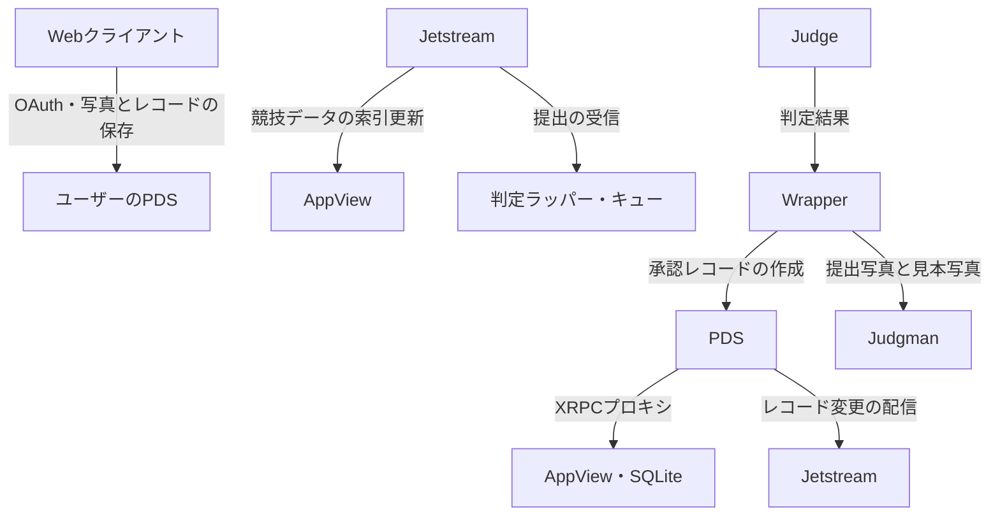

# AtRogaining

## 概要
AtProtoでつながる、ロゲイニングの開催・参加・振り返りを支えるWebサービス。

ロゲイニングは、制限時間内に地図上のチェックポイントを巡り、獲得した得点を競うアクティビティです。AtRogainingは、その楽しさをより気軽に体験できるよう、イベントの募集からチーム管理、競技中の記録、採点、振り返りまでを一つのWebアプリつなげます。

### 背景
私たちのチームは所属しているサークルの合宿でロゲイニングの体験をしました。その際に使用した簡易Webアプリは便利だった一方、短期間で制作したこともあり、使い勝手や機能面に多くの改善点が残っていました。

「楽しかったこの体験を、もっと手軽に開催し、参加できるようにしたい」。そんな思いから、一から作り直すことにしました。

さらに、SNSと連携してイベントの募集・開催・参加ができれば、ロゲイニングを通じて生まれたつながりを、その後の交流にもつなげられると考えてました。

### サービスの説明
誰でも気軽にロゲイニングを開催・参加できるWebアプリケーションです。仲間内で楽しむプライベートなイベントから、広く参加者を募るパブリックなイベントまで、さまざまな場面での利用が可能です。

主催者には準備や採点の負担を減らす仕組みを、参加者には競技に集中できる画面と、思い出を共有できる振り返りの場を提供します。

### 特長
- AtProtoを活用したログイン・チーム管理  
  SNSのアカウントを活用し、イベントへの参加やチームでの活動をスムーズにします。

- 競技中は一画面で完結
  地図やチェックポイントなど、競技中必要な情報と操作を一つのサイトにまとめ、移動中でも迷わず使える設計です。

- 画像判定による採点の自動化  
  チェックポイントで撮影した写真をで判定し、主催者の確認・採点作業を軽減します。

- 体験を共有できる振り返り画面  
  得点だけでなく、通った道や撮影した写真を振り返り、チームの思い出やほかの参加者の体験を楽しめます。

### 解決できること
ロゲイニングの開催には、参加者やチームの管理、チェックポイントの案内、写真の確認、得点集計など、多くの作業が伴います。これらを一つのサービスにまとめることで、主催者の負担を減らし、開催のハードルを下げます。

参加者にとっても、競技中に必要な操作をまとめることで、仲間との相談や街歩きそのものに集中しやすくなります。終了後も写真や記録を共有できるため、その日の体験を交流につなげられます。

### 今後の展望
まずはサークルや友人同士など、小規模なイベントで使いやすさを検証し、実際の主催者・参加者の声をもとに改善していきます。

将来的には、公開イベントの発見や参加、地域の魅力を生かしたコースづくりなどにも対応し、人と人、人と地域がつながるサービスを目指します。

### 注力したこと
実際にロゲイニングを体験した際の気づきをもとに、主催者と参加者の両方が使いやすい設計を重視しています。

特に、競技中の操作を一画面にまとめること、画像判定AIで採点の負担を減らすこと、終了後も楽しめる振り返り画面を用意することに力を入れています。AtProtoを活用し、イベントへの参加を一度きりで終わらせず、その後のつながりへ広げることも大切にしています。

## 開発技術

### 活用する技術

既存のプロトコル・学習済みモデル・ライブラリを活用し、ロゲイニングのデータモデル、採点処理、画面を独自に実装しています。参加者の操作、分散したデータの集約、画像による到達判定を連携させ、写真提出から得点反映までを一つの流れにまとめています。

#### API・データ

|技術|このプロダクトでの用途|
|-|-|
|AT Protocol / PDS|イベントなどをユーザーのPDS（Personal Data Server）上のレコードとして扱い、写真をBlobとして参照します。DIDでユーザーを識別し、AT URIとCIDでレコードとそのバージョンを参照します。|
|AT Protocol OAuth|ブラウザでのログイン・セッション復元・ログアウトに使用します。レコード作成と画像アップロードはPDSへ、独自の参照APIはPDS経由でAppViewへ送ります。|
|@passport|AT Protocolのハンドル入力を補助します。FedCMを利用する経路とリダイレクトへのフォールバックを実装し、取得したハンドルで別途OAuth認証を開始します。|
|Lexicon / XRPC|`win.tomo-x.rogaining.\*` 名前空間で競技用のレコードとAPIを定義し、クライアント・サーバー双方の型と検証コードを生成します。|
|Bluesky Jetstream|イベント・チェックポイント・チーム・提出・承認・不承認の更新を購読し、AppViewの検索・集計用DBへ反映します。|
|OpenStreetMap|チェックポイントや現在位置を表示する背景地図として標準タイルを利用します。地図上に出典を表示します。|
|ResNet-50 / DINOv2|学習済みの画像モデルを特徴抽出器として利用します。画像全体の類似度と局所的な対応関係を、到達判定の入力に使います。|

#### フレームワーク・ライブラリ・モジュール

|領域|主な技術|用途|
|-|-|-|
|Webクライアント|TypeScript、React、React Router、Vite|参加者・主催者の画面、画面遷移、開発・ビルド|
|UI・地図|Tailwind CSS、Lucide React、Leaflet|スタイル、アイコン、地図・マーカー・経路表示|
|AppView|Node.js、Hono、`@evex-dev/xrpc-hono`、`@atproto/lex`|独自XRPC API、Lexiconに沿った入出力検証|
|データベース|SQLite、better-sqlite3、Drizzle ORM / Kit|競技レコードの索引、チーム・提出・審査結果の集計、マイグレーション|
|ブラウザ内保存|IndexedDB|状態と画像Blobの分離保存、再読み込み時の復元|
|画像判定|Python、PyTorch、torchvision、OpenCV、NumPy、Pillow、ImageHash、scikit-learn、Requests|画像取得・前処理、特徴抽出、幾何照合、分類器の学習・推論|
|判定ラッパー|`@bsky/jetstream`、p-queue、execa、TTLCache|提出の受信、並列数制限、外部判定プログラムの起動、レコード取得結果の一時キャッシュ|
|開発・配信|pnpm、GitHub Actions、rsync、systemd|型検査・ビルド、self-hosted runnerからの配信、AppViewのサービス管理|

依存関係は [client/package.json](../client/package.json)、[appview/package.json](../appview/package.json)、[judge-wrapper/package.json](../judge-wrapper/package.json)、[画像判定のrequirements.txt](https://github.com/jphacks/tkb_2625/blob/image/judgman/requirements.txt) を参照してください。CIではNode.js 24・pnpm 11を使用しています。

#### デバイス

* **参加者：スマートフォンのWebブラウザ**。写真の選択・カメラ撮影、Geolocation APIによる位置取得、対応端末での方位取得を利用します。位置情報にはHTTPSまたはlocalhostとユーザーの許可が必要です。
* **主催者：PC・スマートフォンのWebブラウザ**。イベント作成、チェックポイントやチームの管理画面を提供します。
* **サーバー：Node.jsを実行する環境とPython画像判定環境**。画像特徴抽出はCPUで実行し、GPUを必須としない構成です。専用の競技用ハードウェアは使用しません。

### 独自技術

特に力を入れたのは、AT Protocol上の競技データ設計、複数の画像特徴を組み合わせた到達判定、そして提出から採点までをつなぐ非同期処理です。既存のプロトコルや学習済みモデルを基盤に、ロゲイニングの運営に必要な仕組みを開発しました。

#### 1\. AT Protocol上で競技と審査を表現する独自Lexicon

ロゲイニングを、単一のアプリ内だけで完結するデータではなく、AT Protocolのレコードとして表現しました。

|レコード|保持する内容|
|-|-|
|`event`|イベント名、開催期間、指定承認者など|
|`checkpoint`|位置、配点、見本写真、判定用の複数画像、ゴール属性など|
|`team`|イベントへの参照、チーム名、メンバーのDID|
|`submit`|イベント・チェックポイントへの参照、提出写真、位置、日時|
|`approve` / `reject`|対象提出のURI・CID、審査日時、理由など|

提出と審査結果を別レコードにし、AppViewでは**イベントが指定した承認者のDID**と**提出の現在のCID**に一致する審査だけを採用します。これにより、別のユーザーによる承認や、更新前の提出に対する承認を、そのまま現在の審査結果として扱わない構造にしています。

チェックポイントには参加者向けの見本画像と、最大10枚の判定用画像 `internalImages` を定義しました。ただし、`internalImages` という名前や画面での非表示はアクセス制御を意味せず、非公開ストレージとしては扱いません。

実装：[Lexicon定義](../lexicons/win/tomo-x/rogaining)、[審査結果の照合](../appview/src/rogaining/submissions.ts)、[OAuthとPDS / AppView接続](../client/src/lexClient.tsx)

#### 2\. 分散した競技レコードを集約するAppView

PDS上のレコードと、画面表示・得点集計に適した索引DBを分離しました。Jetstreamから変更を受け取り、Lexicon検証後にSQLiteへ登録・更新・削除します。

* 購読カーソルをDBに保存し、再接続時の継続に利用します。
* 提出よりも参照先イベントやチェックポイントの到着が遅れた場合、PDSから不足レコードを取得して索引します。同じURIへの同時取得はまとめます。
* 既存レコードを後から取り込むため、DIDを指定するバックフィル処理を用意しています。
* ランキングでは、承認済みチェックポイントを**チームごとに1回だけ**加点します。ゴールは通常のCP得点と分離し、最初のゴール提出の索引時刻による順位点を計算します。同じ合計点には同順位を付けます。

実装：[Jetstream購読](../appview/src/ingest/jetstream.ts)、[索引・参照補完](../appview/src/ingest/indexer.ts)、[バックフィル](../appview/src/ingest/backfill.ts)、[ランキング集計](../appview/src/rogaining/getRanking.ts)

#### 3\. 複数の見本写真と照合する画像到達判定「Judgman」

「画像全体の雰囲気が似ているか」と「実際に対応する局所的な模様・配置があるか」を組み合わせ、提出写真がチェックポイントと同じ場所を写しているか判定する画像判定エンジンです。撮影方向や写る範囲の違いに対応するため、1地点に複数の参照写真を指定できます。次の2方式を用意し、用途に応じて選択できます。

**方式A：16次元の画像特徴を用いた学習型の判定**

1. ResNet-50による全体・中央領域の埋め込み類似度、pHash / dHash、HSVヒストグラム相関を計算します。
2. AKAZE（利用できない場合はSIFT）とRANSACによる幾何照合から、一致点数、インライア率、対応点の被覆率、重なりを取り出します。
3. DINOv2のパッチ特徴の対応とCLS特徴の類似度を加え、16次元の特徴ベクトルにします。
4. ロジスティック回帰によるFusionと、独自実装したLIFニューロンのスパイキングニューラルネットワーク（SNN）でスコアを算出し、重み付きで合成します。
5. 複数参照では各写真とのスコアの最大値を採用し、単一参照とは別のしきい値で判定します。

SNNには膜電位の減衰・発火・リセットと、学習用の代理勾配を実装しています。FusionとSNNの合成比率や判定しきい値は検証データを使って調整し、Fusionのみを採用する設定も選べます。

**方式B：SIFTとDINOv2によるルールベースの判定**

SIFTの対応点をRANSACで検証したインライア数・比率と、DINOv2の特徴ベクトルのコサイン類似度を組み合わせます。「一致」「不一致」に加えて、判断材料が十分でない場合の「判定保留」を返します。各指標は複数参照の中から最良の値を採用する実装です。

`judgman/main.py` では `model\_num=0` で方式A、`model\_num=1` で方式Bを選択できます。一致を終了コード0、それ以外の判定を1、実行時エラーを2で返します。方式Bの判定保留もCLIでは1になるため、自動承認の対象にはしません。

関連コード：
[特徴抽出](https://github.com/jphacks/tkb_2625/blob/image/judgman/judgman/features.py) /
[DINOv2照合](https://github.com/jphacks/tkb_2625/blob/image/judgman/judgman/dino.py) /
[Fusion](https://github.com/jphacks/tkb_2625/blob/image/judgman/judgman/fusion.py) /
[SNN](https://github.com/jphacks/tkb_2625/blob/image/judgman/judgman/snn.py) /
[複数参照の統合](https://github.com/jphacks/tkb_2625/blob/image/judgman/judgman/judge.py) /
[SIFT＋DINOv2判定](https://github.com/jphacks/tkb_2625/blob/image/judgman/judgement.py) /
[CLI](https://github.com/jphacks/tkb_2625/blob/image/judgman/main.py)

画像全体の類似度だけでなく、局所特徴の幾何的な整合性も判定材料にする点が特徴です。主催者が複数の見本写真を登録できるため、一方向からの見え方だけに依存しない照合ができます。

#### 4\. 提出受信と画像判定を分離する非同期ラッパー

画像判定に時間がかかっても提出イベントの受信を止めないよう、Jetstreamで受信した `submit` をp-queueへ積む構成にしています。

* 同時実行数を3件に制限し、各ジョブ内で画像の取得先を解決して外部判定プログラムを起動します。
* イベントの指定承認者が自分のDIDである場合だけ処理し、ゴール提出は画像判定から除外します。
* 終了コード0の場合に、提出URI・CIDを参照する `approve` レコードをPDSへ作成します。
* 1件の例外はログに記録し、他のジョブの処理を継続する構成です。

判定エンジンは独立したPythonプログラムとして呼び出し、ラッパー側は提出の取得と承認レコードの発行を担当します。判定ロジックとAT Protocolへの接続を分離することで、画像判定方式の変更が、受信・採点連携の処理全体に広がりにくい構成にしました。

実装：[判定ラッパー](../judge-wrapper/src/main.ts)

#### 5\. 競技中の操作をまとめた画面と画像保存

チェックポイントのカード表示、状態別の絞り込み、写真提出・再提出、チームの得点・履歴、地図表示を実装しました。地図にはチェックポイントと実測GPSによる現在位置・経路を表示し、位置情報の監視は停止時や画面離脱時に解除します。

ブラウザ内の保存では、画像BlobをIndexedDBに保存し、状態側には画像IDを持たせます。状態と画像を同じトランザクションで保存し、保存が失敗した場合は画面側の確定状態も更新しない構成です。UI、操作を処理するサービス、データを保存する層を分離し、画面の使いやすさと保存処理の整合性を両立させています。

実装：[参加者画面](../client/src/App.tsx)、[地図・GPS](../client/src/MapPage.tsx)、[操作の直列化](../client/src/service.ts)、[状態と画像の保存](../client/src/repository.ts)

### システム構成

1. 主催者がイベント・チーム・チェックポイントと見本写真を登録します。
2. 参加者が地図を見ながらチェックポイントを巡り、写真と位置情報を提出します。
3. Jetstreamを通じて提出を受信し、キューに積まれた写真をJudgmanで判定します。
4. 一致した提出に承認レコードを発行し、AppViewがチームの得点とランキングへ反映します。
5. 参加者は獲得した得点、提出写真、移動の記録を振り返れます。

この構成により、ユーザーの記録を保持するPDS、表示・集計を担当するAppView、画像判定を担当するJudgmanが、それぞれの役割を分担します。

### 開発で工夫したこと

* **本人の記録と審査者の判断を分離**：写真提出と承認を別のレコードにし、誰がどの提出を審査したかを参照できる構造にしました。
* **複数の根拠を使う画像判定**：学習済みモデルの類似度に、局所特徴・幾何照合・複数の見本写真を組み合わせました。
* **重い処理を画面や受信処理から分離**：写真判定をキューで処理し、同時実行数を制限します。
* **主催者と参加者の操作を一貫させる設計**：イベント・チェックポイント・提出・審査・得点を共通のデータモデルでつなげました。
* **競技中の操作を簡潔に**：カード・地図・写真提出・チーム情報をまとめ、移動中に必要な情報へアクセスしやすくしました。

